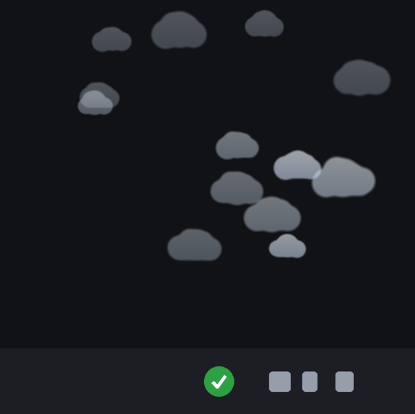
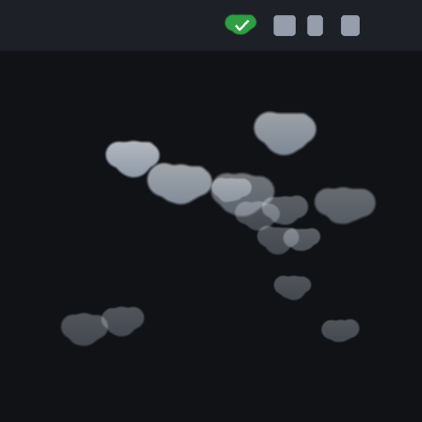

# Architecture and rendering

[Home](../README.md) | [Windows guide](windows.md) | [macOS guide](macos.md) | [Troubleshooting](troubleshooting.md)

This guide keeps implementation details off the main setup page. Historical
measurements below describe the named test versions, not every current machine.

## Process layout

Windows uses a tray, an exit watcher, a supervisor, and up to four dialog-scoped
PowerShell workers. The puff overlay and burst dialog start when needed.
The desktop Explorer process starts the tray after the launch guard checks the
parent and Windows job limits. The exit watcher records the tray's exit code.
The supervisor owns a kill-on-close job for its workers; closing it stops them.
Direct standalone `watcher.ps1` use remains synchronous and has no supervisor.

With the optional Windows held-connection setting enabled, the tray also owns
`relay_windows.py`. It uses the shared `cdp_relay.py` transport, opens Chrome
on client demand, and retains one connection for sequential clients. It binds
to the original tray process identity and exits when that parent ends. Status
sampling runs separately from process control, so slow file reads do not delay
shutdown. Off, pause, Observe only, and Quit stop the owned relay without
closing Chrome. The separate resident Chrome DevTools MCP bridge is not managed
by Yes, Dev.

On macOS, the menu-bar app owns the Accessibility engine and optional overlay,
burst dialog, and focus helper. Fast focus uses a local relay and its early-focus
helper. Those helpers are tied to their parent processes. The relay can keep an
approved Chrome socket open while the feature is enabled.

The tray consumes persisted `[ACTION]` records for the approval count, notices,
and burst guard. A returned action API call alone is not a confirmed approval.
The tray owns configuration and the disarm timer. Changing an engine startup
option restarts that engine. See [troubleshooting](troubleshooting.md#logs-and-settings)
for current log locations and retention; they do not all use one rotation policy.

The common approval settings use the same keys and defaults on both platforms.
Both platforms add relay settings; macOS also has focus settings. Both builds read `utf-8-sig` so settings
copied from Windows can include a byte-order mark. The macOS settings writer
validates changes and replaces the file atomically, retaining unknown keys.

### Finding the dialog on Windows

The tray starts `watcher_supervisor.py`, which enumerates visible top-level
`Chrome_WidgetWin_1` windows and verifies each consent title and browser owner.
The idle path uses Win32 calls and does not scan the accessibility tree.

The supervisor runs at most four `watcher.ps1` workers. Each worker is restricted
to one window handle and browser PID. A worker reports progress after each sweep;
if no sweep completes for five seconds, the supervisor terminates that worker
and retries the prompt with the native legacy method first. Startup has a separate
ten-second limit. Other dialogs can proceed while a provider call is blocked.
Stopping the supervisor also stops its workers through a Windows job object.
Supervisor startup and recovery records go to `%LOCALAPPDATA%\YesDev\supervisor.log`.

The engine invokes the matching Allow button through `InvokePattern`. If that
fails, it uses the native `LegacyIAccessible` COM interface for the same button
runtime ID inside the same dialog. Neither method moves the mouse or changes focus.

An action call is logged as an attempt. The engine writes one `[ACTION]` event
only after the original dialog/button disappears. A pending entry holds only
the window handle, process ID, button runtime ID and method name, not live UI
Automation objects. Repeated attempts on one prompt do not increase the tray
counter or burst rate. A new button identity can be handled immediately even if
Windows reused the window handle.

The counter measures dialog dismissal after an approval action. It cannot inspect
another client's protocol session. The isolated browser tests verify successful
CDP connections separately, and require one counter event per tested connection.

The log writer serializes worker appends and rotation with a named mutex. It
releases that lock before console output. It permits concurrent reading and uses bounded retries for short
file locks. A confirmation stays pending until its ACTION record is saved. A
reader that blocks log rotation does not cause the current event to be dropped;
the engine appends it and retries rotation on a later write.

### Finding the dialog on macOS

Same shape of problem, different tree. Here the dialog *is* attached to the
browser window, as an `AXSheet`, wrapping an alert whose subrole is the thing
worth matching on:

```
AXApplication  "Chrome"
  AXWindow  "<tab title> - Google Chrome"
    AXSheet  "Allow remote debugging?"                    <-- dialog host
      AXGroup / AXSubrole=AXApplicationAlertDialog
        AXButton  "Turn off in settings" | "Cancel" | "Allow"
```

That is the shape on Chrome 152 and 154. Chrome 153 leaves the sheet's own
title empty and puts the same string on an `AXHeading` inside it, so an untitled
sheet whose heading matches counts as the host too. The heading walk is shallow
and runs only for untitled dialogs, so the idle scan still costs well under a
millisecond per Chrome process.

`watcher_mac.py` walks each Chrome process's windows, sheets and children,
matches by title (or heading) *and* role, and presses the button with
`AXPress` - with no mouse movement, and without activating Chrome.

It does not press straight away. Chromium discards input for half a second
after a security-sensitive dialog appears, and on Chrome 154 that includes
`AXPress`: a press inside that window returns success and does nothing. So a
sheet is pressed only once it has stood for that guard, measured from the sweep
that first saw it. That costs at most one poll plus the guard in latency and
makes the first press land. Measured on 154 with three clients queued: before
the guard, every first press was swallowed and every approval needed a second
sweep; after it, one press per sheet.

An approval is logged only once the sheet is verified gone, and "gone" is judged
by the AX references that were pressed, never by what now sits at those
coordinates - Chrome draws the next queued prompt exactly where the last one was,
so a geometry check would call a dismissed sheet still up and miss a real
approval.

If the sheet still stands after the press, the engine falls back to the
keyboard: it writes `AXFocused` onto the Allow button and posts a Space
keystroke to Chrome's process with `CGEventPostToPid`, which delivers keyboard
events without moving the pointer. Every keystroke is gated on the pressed sheet
still being the same live node, re-read before the focus write and immediately
before Space, so a key is never posted at a sheet that has already gone. This
path only works with **Keyboard navigation** on (System Settings > Keyboard);
with it off, Chrome declines the focus write and Tab cannot reach the button, so
the engine sends nothing and simply retries next sweep. There is still no
synthetic mouse click anywhere in the engine. A sheet that outlives both routes
is logged FAILED and pressed again next sweep.

Two macOS-specific traps recorded with the [Accessibility probe](mac/ax_probe.py):

- **The title alone is not enough.** It also matches the Window menu's
  `AXMenuItem` for the dialog, and an `AXHeading` inside it. Matching role as
  well as title is what separates the real dialog from its echoes.
- **There is no `GetRuntimeId()`.** Chrome sets no `AXIdentifier` on this alert,
  so deduplication keys on position and size instead. Note that `AXPosition`
  comes back as an `AXValue` and must be unwrapped with `AXValueGetValue` -
  pyobjc has no `.pointValue()`, and a key that silently falls back to object
  identity changes on every sweep, which defeats the dedupe entirely.

macOS also demands an **Accessibility grant** that has no Windows equivalent.
This is TCC, it is deliberate, and it cannot be scripted around: AppleScript and
System Events need exactly the same grant, so there is no side door.

### The puffs

A toast card per approval is worse than the problem when approvals fire dozens
of times an hour, so the default notice is a small translucent cloud that drifts
away from the tray and fades out. Position, size, speed, drift, lifetime and
release delay are all jittered, so a burst scatters instead of stacking. The
windows are click-through and non-activating - they never take focus or swallow
a click. Warnings (burst guard, auto-disarm) still use a real toast, because
those carry text you need to read.

| Windows | macOS |
|---|---|
|  |  |
| *__Windows.__ The tray sits at the bottom of the screen, so a cloud is released there and **rises** away into open desktop.* | *__macOS.__ The status item sits at the top, so a cloud is released just under the menu bar and **falls** away from it - and hangs, flipped, rather than sitting on its flat base.* |

That direction is the one deliberate behavioural difference between the two
builds, and it is forced rather than chosen. Rising was tried first on macOS and
measured: released level with the status item, a cloud crossed the menu bar
within a second and spent the rest of its life off-screen, still ~40% opaque.

Every cloud is generated, never a stored asset: five jittered lobes over a flat
base, blurred for soft edges, put through a contrast curve so the silhouette
still reads as a shape, then shaded with a vertical gradient. No two are alike.
The macOS overlay flips only the **alpha mask**, not the whole image - flipping
the image carries the shading with it and lights the cloud from below, which
looks wrong hanging under a menu bar.

Neither picture is a mock-up or a hand-arranged row. `docs/make_art.py` and
`docs/make_art_mac.py` replay a real burst and freeze it mid-flight, taking the
shapes, spawn positions, speed, drift and fade straight from `puffs.py` and
`puffs_mac.py`, so the art cannot drift from the app. The two generators are
built the same way and to the same size, so the pair sits level and any
difference you see between them is a real difference in the app rather than an
artefact of how the picture was made.

The bar along the edge of each image is a generic stand-in. Neighbouring icons
are placeholders for scale. The current Windows and macOS tray icons use the
shared cloud renderer; historical preview art can show an earlier icon.

Both are shown on a dark ground because the clouds are built to read over a
taskbar and would be nearly invisible on a white page. `docs/clouds.png` and
`docs/clouds-mac.png` are the same frames with transparent backgrounds and no
bar, and `docs/cloud.png` is a single cloud, for reuse elsewhere.

#### Windows: layered windows

The clouds are drawn as 32-bit bitmaps and handed to the compositor with
`UpdateLayeredWindow`, not painted by Tk. Colour-keyed transparency can only
make one exact colour disappear, which forces hard aliased edges; per-pixel
alpha gives soft edges and a shaded underside, and one call moves and fades a
cloud together.

Three Windows quirks cost real time here and are worth knowing if you touch
`puffs.py`:

- **Tk will not paint from a worker thread.** Toplevels created off the main
  thread are reported visible by `IsWindowVisible`, sit at the right
  coordinates, and render solid black. Identical code on the main thread paints
  fine. Since pystray owns the parent's main thread, the overlay runs as its own
  small process (`puffs.py --serve`) that takes one integer per line on stdin.
- **Order matters around `SetWindowLongW`.** Applying the click-through ex-style
  to a window that has not been realized yet drops its layered attributes and it
  stays invisible forever. Call `update_idletasks()` first, then set the style,
  then push the bitmap.
- **Declare argtypes, not just restype, for anything taking a handle.** With only
  a restype set, ctypes passes a Python int as a C int and a 64-bit `HDC`
  overflows it - `CreateDIBSection` fails with "argument 1: OverflowError: int
  too long to convert", the window never gets its pixels, and a plain white
  rectangle sits there instead of a cloud.

#### macOS: transparent NSWindows

Easier than Windows, because per-pixel alpha is native: a borderless `NSWindow`
with `setOpaque_(False)`, a clear background, `setIgnoresMouseEvents_(True)` for
click-through, `NSStatusWindowLevel` so it floats above ordinary windows, and
`orderFrontRegardless()` to show without stealing focus. `setAlphaValue_` does
the fade and `setFrameOrigin_` the drift. No colour key, no premultiplication,
no layered-window ordering trap - the premultiplied path in `_render_cloud`
exists only for `UpdateLayeredWindow`, and macOS wants straight alpha.

Three things to get right:

- **Coordinates are flipped.** The macOS origin is bottom-left. Falling is `-y`
  here; rising on Windows is *also* `-y`. Same sign, opposite direction.
- **Use `NSScreen.visibleFrame`**, not `frame`, so the menu bar and Dock are
  excluded. It is the counterpart of `SPI_GETWORKAREA`.
- **Render at `backingScaleFactor` and size the image in points**, or the art is
  an upscaled 1x asset on a retina display.

On both platforms: **never let a frame kill the animation loop.** An exception
between scheduled callbacks stops the reschedule, and every cloud on screen
freezes there permanently, in the user's face. Catch per-frame, destroy what is
live, and keep the loop going.

Set `YESDEV_DEBUG=1` to have the overlay log spawns and failures to `puffs.log`
in the data directory.

## Files

| Path | Role |
|---|---|
| `yes_dev.pyw` | Windows tray UI, engine supervisor, config |
| `yes_dev_mac.py` | macOS menu-bar UI, engine supervisor, config |
| `settings_mac.py`, `settings_model.py` | Native macOS settings window, validation, atomic persistence |
| `watcher.ps1` | The UI Automation engine. Runs standalone too. |
| `watcher_supervisor.py` | Windows prompt discovery, scoped workers, and stall recovery. Used by the tray. |
| `windows_runtime.py` | Desktop launch broker, lifecycle records, and the independent tray exit watcher. |
| `watcher_mac.py` | The Accessibility engine. Runs standalone too. |
| `platform_mac.py` | macOS paths, single instance, permission check, autostart |
| `puffs.py` | The cloud overlay and the shared artwork. Its own process. |
| `puffs_mac.py` | The macOS cloud overlay. Its own process. |
| `focus_guard_mac.py` | The macOS focus guard behind Quiet focus. Its own process. |
| `cdp_relay.py` | Shared loopback CDP transport, held reuse, client cleanup, and request limits |
| `relay_windows.py` | Windows relay host, parent identity, status, retry, and owned-child lifecycle |
| `relay_mac.py` | macOS relay host and early-focus integration |
| `early_focus_guard_mac.py`, `focus_protocol.py` | Early-focus helper and single-use request policy |
| `burst_dialog.py` | The five-second burst prompt. Also its own process. Shared. |
| `docs/mac/ax_probe.py` | Dumps Chrome's accessibility tree around the dialog |
| `tests/mac/` | Measures the focus guard against a stand-in that steals focus the way Chrome does |
| `docs/make_art.py`, `docs/make_art_mac.py` | Regenerate the cloud art from `puffs.py` |

The Windows package contains the files listed by `packaging/build_windows.py`.
The build and extraction checks are described in [packaging](../packaging/README.md).
Current builds include the Windows relay modules and websockets. The published
v1.5.0 Windows package predates that feature.

## Standalone observation

```powershell
powershell -NoProfile -ExecutionPolicy Bypass -File watcher.ps1 -Observe
```

```bash
python3 watcher_mac.py --observe
```

Standalone use is for diagnostics. It does not provide the tray's burst guard or
disarm timer. Other language patterns require changes to both Windows discovery
and worker matching for supervised mode; worker arguments alone do not change
the supervisor's title filter.
